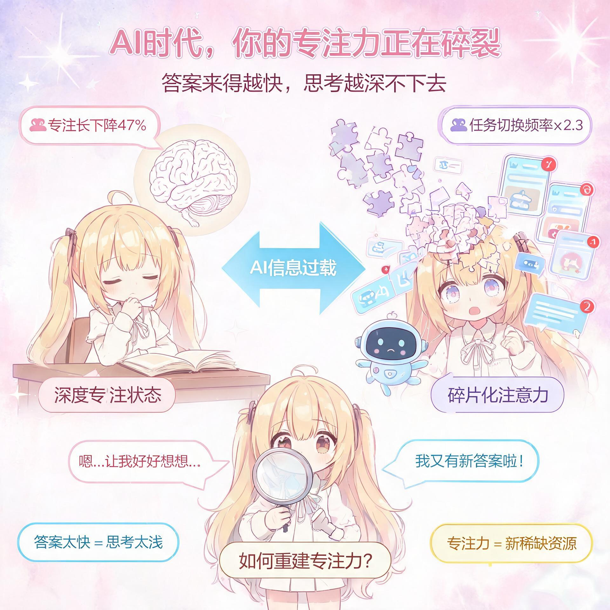
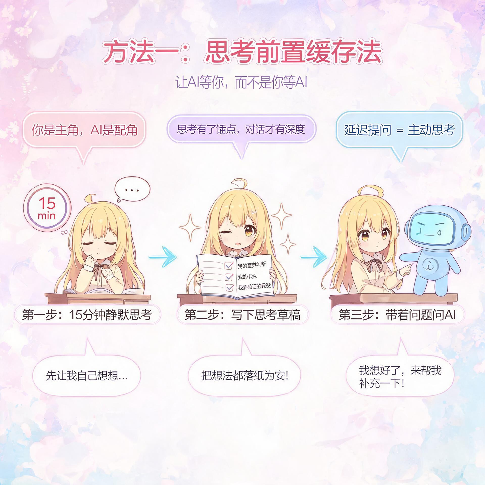
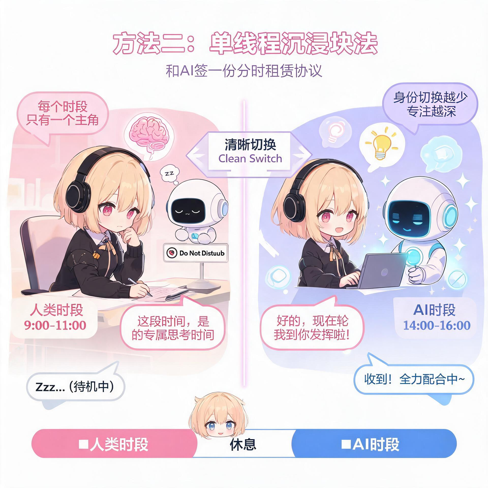
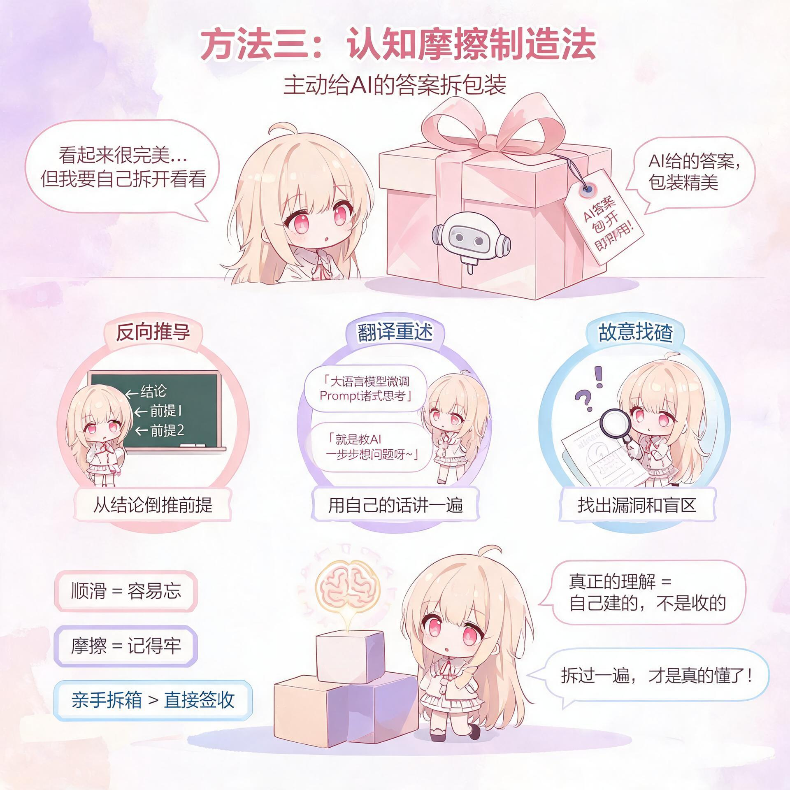

# AI时代正在杀死你的专注力？3个反常识的深度工作法

> 当信息唾手可得，专注成了最贵的奢侈品

主标题：AI时代正在杀死你的专注力？3个反常识的深度工作法
正文：
## 引子：你有多久没有"一口气做完一件事"了？

早上九点坐到工位，打开文档的第一秒，弹窗提示"AI为您生成了3条待办建议"；写方案写到一半，随手问了AI一个数据问题，返回结果里附带的"相关推荐"又把你拽进三条行业快讯；下午三点的深度工作时段，对话历史里二十个来回的提示词交错堆叠，你甚至想不起自己最初要解决的到底是什么。这不是某个人的自律危机，而是整个时代的注意力正在经历一场"碎片化降维打击"。数据正在敲响警钟：多项认知科学研究显示，频繁使用生成式AI的知识工作者，平均专注时长较三年前下降了47%，任务切换频率却翻了2.3倍。吊诡之处在于——AI明明在帮我们省时间，我们却越来越没时间把一件事想透。真相往往藏在反直觉的角落：**专注力的敌人不是信息太少，而是"答案来得太快"；深度工作的最大障碍不是不够努力，而是努力的入口被AI撬得太宽，宽到我们再也找不到那扇窄门。** 当思考的阻力被无限降低，思考的深度也在同步蒸发。这场专注力保卫战，不能靠"卸载APP""断网一小时"这类田园牧歌式的解决方案——我们需要的，是一套和AI共存的深度工作新语法。

## 方法一："思考前置缓存"法——让AI等你，而不是你等AI

多数人的工作流是这样的：遇到问题→立刻问AI→边看答案边思考→再追问→再调整。这个流程看似高效，实则暗藏一个认知陷阱：**你的思考节奏，被AI的响应速度绑架了。** AI秒回，你的大脑就秒接；AI抛出十个角度，你的注意力就被劈成十片。等你反应过来，两小时过去了，脑子里装的全是AI的碎片，自己的主线早已模糊。"思考前置缓存"法，就是把这个顺序彻底颠倒过来——不是先问AI再想，而是先想透再问。操作只需要一个简单的动作：在向AI提问之前，强制自己用15分钟写一份"思考草稿"。这份草稿不需要完美，甚至不需要正确，它只需要回答三个问题：①我对这个问题的直觉判断是什么？②我目前卡在哪三个具体节点上？③如果只能验证一个假设，我最想验证哪个？把这三点写下来的过程，就是给大脑"预热点火"的过程——你不再是AI输出的被动接收器，而是带着自己的坐标系去和AI对话。更进阶的玩法是"提问延迟满足"：把今天想问AI的问题全部记进一个清单，攒到下午四点统一提问。你会惊讶地发现，清单上有三分之一的问题，在你自己做事的过程中已经有了答案；还有三分之一，在你反复琢磨后，问题本身已经变得更锋利了。**专注力的本质，是对注意力的主权宣告——不是AI什么时候给答案你什么时候看，而是你什么时候准备好，什么时候才打开那扇门。**

## 方法二："单线程沉浸块"法——和AI签一份"分时租赁协议"

多任务处理是专注力的头号杀手，这是常识。但在AI时代，这个杀手换了一张更隐蔽的脸：它不再让你同时做两件事，而是让你在"自己想"和"让AI想"之间高频横跳。写一段，问一下AI；改一版，让AI润色一下；想到一个点子，立刻让AI评估可行性。这种"人机交替模式"看似在协作，实际上每一次切换都是一次注意力的"硬重启"——认知科学家称之为"注意力残留效应"：从任务A切换到任务B后，大脑的一部分资源仍残留在A上，需要23分钟才能完全进入B的状态。"单线程沉浸块"法，就是给你的一天划分出两种泾渭分明的时段：**"人类时段"和"AI时段"。** 在"人类时段"里——比如上午9点到11点——你把AI工具彻底最小化，手机翻过来扣在桌上，只做一件事：用你自己的脑子，把核心问题从混沌想到雏形。这两个小时里，不许查资料、不许问AI、不许做任何"获取输入"的动作，只允许"输出思考"。你会痛苦，你会觉得效率低，你会忍不住想"让AI先给我个框架多快"——但请忍住，因为正是这份"慢"，才是深度思考的土壤。然后在"AI时段"里——比如下午2点到4点——你再把上午沉淀的思考拿去和AI碰撞，让AI帮你补盲区、挑漏洞、扩素材。关键在于：**每个时段只有一个主角，要么是你，要么是AI，绝不同台。** 就像你不会让厨师和食客同时站在灶台前，你也不该让思考者和工具在同一段时间里争夺大脑的主控权。专注力不是管理时间的艺术，而是管理"身份切换"的艺术。

## 方法三："认知摩擦制造"法——主动给AI的答案"拆包装"

AI最危险的地方，不是它会犯错，而是它太"顺滑"了——一个完整的答案，逻辑自洽、结构工整、语言流畅，像一份包装精美的礼物，你几乎不需要花任何力气去"拆"。可大脑的一个残酷真相是：**理解的深度，和拆解信息时的摩擦力成正比。** 你自己啃一篇论文啃了三天才搞懂的东西，和AI用三句话给你讲明白的东西，在你脑子里留下的刻痕深度，差了不止一个数量级。前者是你用自己的认知脚手架一步步爬上去的，后者是坐直升飞机上去的——你看到的风景一样，但脚下没有根基。"认知摩擦制造"法，就是主动给自己"添麻烦"——把AI给的现成答案，重新"拆碎了再拼回去"。具体怎么做？三个实用操作：①"反向推导"——AI给了你一个结论，你遮住推导过程，自己从结论往回推，问问自己："要得到这个结论，需要哪几个前提？每个前提又需要什么证据支撑？"推到推不动的地方，就是你真正的认知盲区，再去对照AI的推导，那一刻的恍然大悟，才是真的学会了。②"翻译重述"——AI用它的语言讲了一遍，你强迫自己用你自己的话、用你身边人的故事、用你熟悉的领域的比喻，把这件事再讲一遍。讲不出来的地方，就是你没有真懂的地方。③"故意找碴"——拿到AI的答案后，先花十分钟找它的漏洞、找它没说清楚的地方、找它逻辑跳跃的地方。找不找得到漏洞不重要，重要的是这个"找"的过程，迫使你从被动接收切换到主动审视。**顺滑是理解的敌人，摩擦才是记忆的朋友。AI把答案包装得越漂亮，你越要有亲手拆箱的勇气——因为真正长在你脑子里的，从来不是答案本身，而是拆答案的那双手。**

## 延伸思考：为什么专注力在AI时代反而成了"超级权力"

回看人类历史上每一次信息介质的革命——从印刷术到广播电视到互联网——有一条隐秘的规律从未改变：**信息越廉价，注意力越昂贵；答案越易得，提问越稀缺。** 印刷术普及之前，能读书的人是少数，知识本身就是壁垒；而今天，知识已经成了空气——你随时可以获取，但没人告诉你该吸哪一口。AI把这条曲线推到了极致：过去你需要花一周查资料搞清楚的事，现在30秒就有了答案。可问题是，如果所有人都能在30秒内得到同样的答案，那人与人的差距体现在哪里？答案藏在两个被忽视的维度里：一个是"能在没有答案的时候，自己造出答案的能力"——也就是深度思考的能力；另一个是"能在一千个答案里，闻出哪个是对的的能力"——也就是判断力。而这两种能力，共享同一个底层基础设施：专注力。你能连续专注一小时，就只能做一小时深度的事；你能连续专注三小时，就能摸到问题的底层结构；你能专注一整天，也许就能击穿一个领域的认知天花板。**AI给了每个人一把锤子，但钉子在哪、往哪钉、钉多深，这些只能靠专注力来回答。** 更值得警惕的是，专注力的"贫富差距"正在以肉眼可见的速度拉大：那些掌握了深度工作方法的人，正在用AI把自己的认知杠杆撬到前所未有的高度；而那些把思考外包给AI的人，正在一次次"顺手一问"中，把自己专注的肌肉一点点萎缩掉。这不是一场工具的竞赛，这是一场注意力的军备竞赛。

## 结语：在算法的洪流里，做一个"走神很慢"的人

三年前我们谈专注力，谈的是"如何抵抗手机的诱惑"；今天我们谈专注力，面对的是一个更隐蔽、更强大的对手——一个永远在线、永远有答案、永远说得头头是道的AI助手。它不抢你的时间，它只是让你的思考"起点"越来越低；它不打断你，它只是让你"自己想"的那个冲动越来越弱；它甚至不会让你觉得不舒服——恰恰相反，它让你觉得效率很高、收获满满，直到某一天你突然发现，离开了它，你连一段完整的话都写不顺。但真正的希望也在这里：正因为AI让大多数人的专注力在悄悄贬值，那些还能守住深度思考阵地的人，价值才会被前所未有地放大。未来的稀缺人才，不是知道最多答案的人——答案AI都知道——而是那些能在噪声中锁定方向、在混沌中锚定问题、在碎片中拼出整幅图景的人。**他们不是比别人更聪明，只是比别人更"慢"——慢到不会被每一个新答案拽走，慢到能和一个问题死磕到底，慢到让思考在自己的脑子里扎根、发芽、长出自己的形状。** 所以，从今天开始，给自己留一段"没有AI的时间"，留一些"自己想明白的问题"，留一点"拆答案的麻烦"——你守住的不是专注力，而是在这个答案漫天飞舞的时代里，依然属于你的、不可替代的思考主权。
