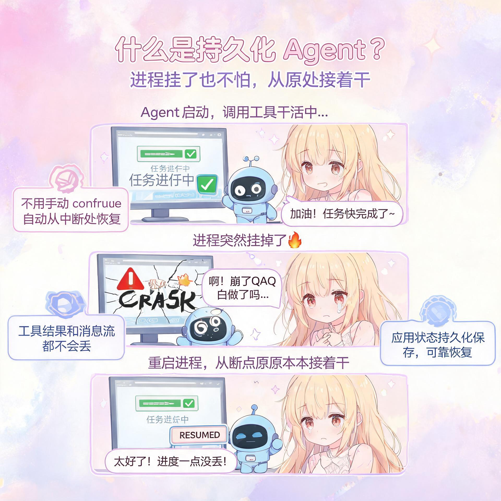
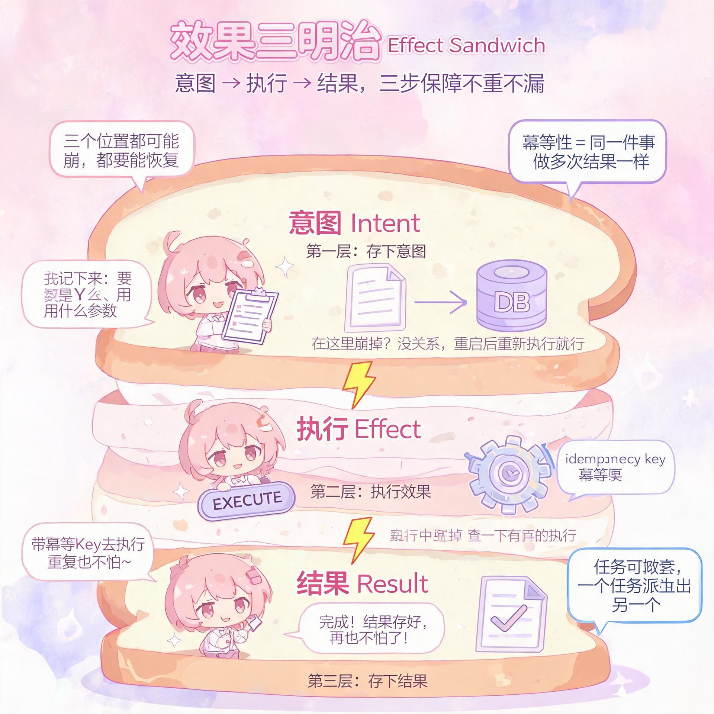
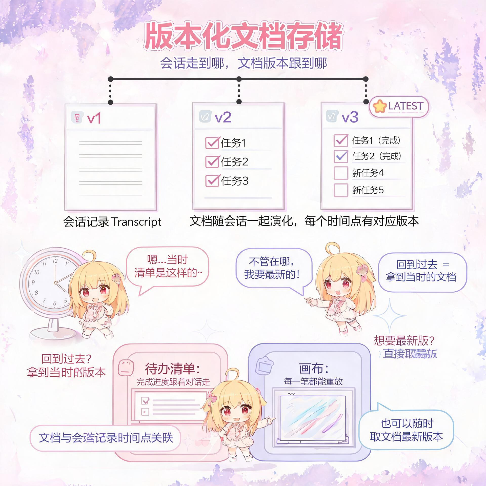
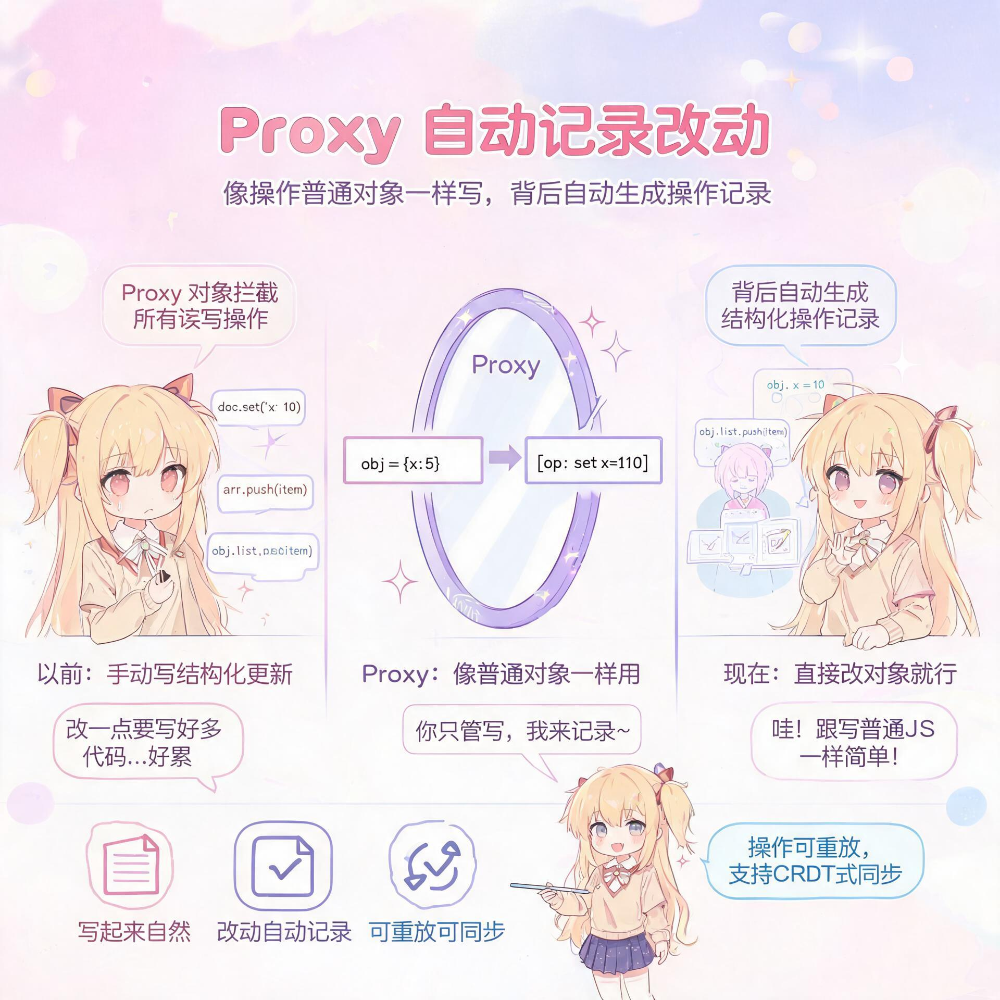
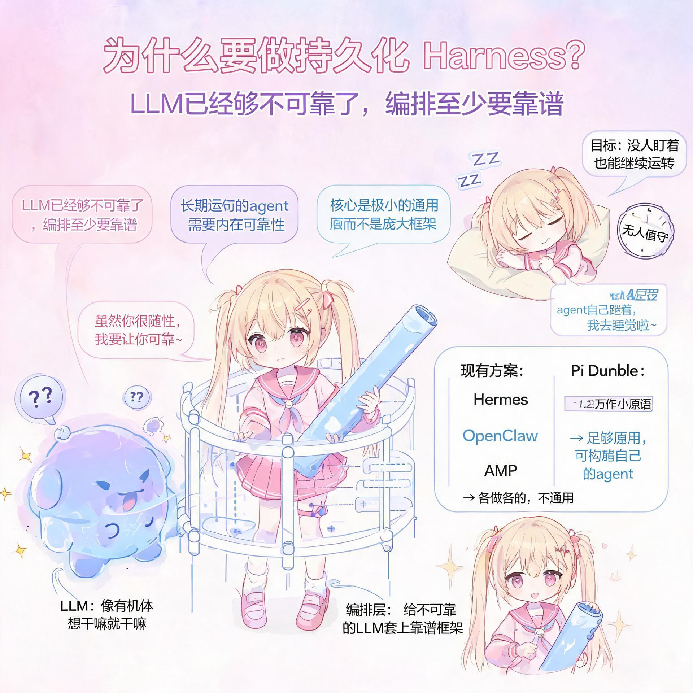
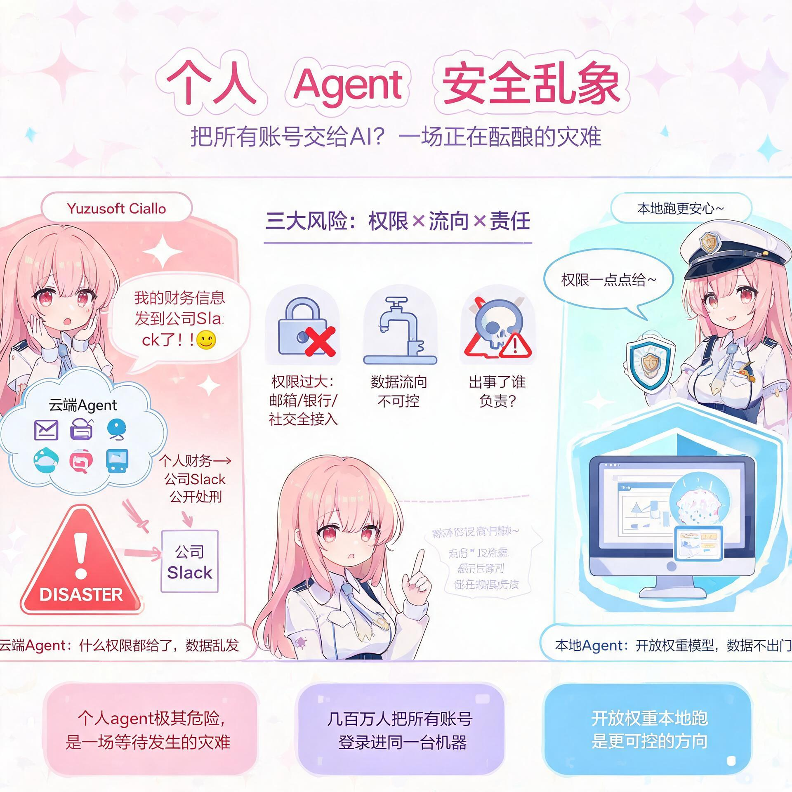

# agent 崩溃之后，从原处接着干

## 第二部分

## 20:36 Pi Durable 是什么？用五句话讲清持久化 agent

我不知道，你没法用那东西来构建应用。它只是个爬山（hill climbing）那类的技能，这有点让人失望。主持人：我确实想问问你们关于 Pi Durable 的事。你们用了 durable（持久化）这个词，背后的逻辑是什么？这到底是怎么回事？Armin：我试着用五句话讲清楚，好吗？agent 在一个进程里启动，agent 调用工具，进程挂掉。你想要的是：重启进程，agent 从它中断的地方原原本本地接着继续。

Armin：这就是持久化（durability）。你不用手动输入 continue，工具结果和 assistant 的消息流也不会丢，你的应用状态也被持久化地保存下来，并可靠地从中恢复——这就是持久化。为什么需要它？因为对于长期运行的 agent——任何 Claw 那类的东西——你都需要这个。Pi Durable 解决的另一件事是：以前 Pi 基本上会把整段对话，或者说 Pi 里的整棵对话树，都加载进内存里。如果你的 Slack bot 在你的 Slack 里一待就是好几年，它的完整对话记录里攒了一大堆消息，那显然就行不通了。这些不一定是你发给 LLM 的内容，但你仍然需要能拿到全部历史。这基本上就是 Pi Durable 干的事。另外它还很容易部署到很多地方，比如 Vercel、Cloudflare DO、E2B、你的笔记本、我的手机，这让它用起来很有意思。主持人：也许你可以带我稍微过一下它的架构。

Mario：我今天确实读了那个 repo，还让一个 clanker（Claude）也试着给我讲讲这是怎么回事。resumability（可恢复性）我大概理解的是：你得提交（commit）一个 action——至少这是我理解的。你有一个 action，这个 action 得被提交进文件里，这样它才算正式生效（canon）。如果它中途掉了，你就有这么一个事件队列。

## 22:28 效果三明治：意图、效果、结果

Mario：所以就是队列里有一堆事件，至少我是这么理解的。对吧？Armin：对，这正是我们不做的。我们不做事件溯源（event sourcing）。那是其他所有人都在做的，嗯哼。我们不那么做，因为它有一堆问题。反过来，让我讲讲我们是怎么做的，好吗？持久化的基本问题是：你在执行某个东西，它可能在三种时机崩掉——在你开始执行之前、执行过程中、或者执行完之后，

Armin：对吧？而你要执行的那个东西，通常被称为一个 effect（效果）。所以大多数持久化方案接下来会这么做：在我执行它之前，我先往某个存储里写点东西，说"我即将用这些参数、这些输入来执行这件事"，对吧？这样如果我在存完之后崩了，我就知道我已经把所有的输入都正确评估过了，我已经验证过它们，准备好执行了。如果我的进程现在挂了——还没执行，但已经存下了这个意图（intent）——我就可以重启，看看数据库，发现有一件"即将用这些输入发生"的事。因为它还没执行，那我就直接做掉它，现在做，对吧？这是三明治的第一部分。第二个可能崩的地方，是 effect——也就是执行——真正在跑的时候。这取决于具体在跑什么。如果是个外部系统，比如你发到 GitHub Actions，让它在这个 action 里构建这个 commit，对吧？你把这个发出去。然后你的进程挂了，你重新拉起，这时候你不一定知道这件事到底执行了没有，因为你还没存任何东西，因为你还没收到结果回来。你跟 GitHub 说到一半被打断了，对吧？那这种情况怎么继续呢？GitHub 这里很简单，因为你可以在 run 跑起来之前说"我要调度一个 run"，然后你会拿到一个 key。在真正执行那个 run 之前，你可以先把它存下来，对吧？也就是一个 ID。这样如果我接下来执行那件事，我就说"用这个 ID 去执行"，对吧？如果它已经在跑了，GitHub 会告诉我它已经在跑了，好，那我就等，然后我把结果给你。如果它还没跑，GitHub 就会用那个 ID 启动那个 run，对吧？这就叫幂等性（idempotency）——

Mario：Armin，你最喜欢的词，幂等性。Armin：我他妈就是念不出来。idempotency。Mario：对。太酷了。Armin：所以如果我们的外部系统有这个特性——我给它一个 ID，说"用这个 ID 做这件事"，而这件事已经在跑了——

Armin：它会告诉我"我已经在做了，等它跑完"，那我就能在我的 effect 崩溃之后也活下来，对吧？最后一步是：一旦那个 effect 跑完了，我拿到一个结果，把这个结果存起来，这时我的效果三明治（effect sandwich）——意图、effect 的执行、effect 结果的存储——就完成了。之后我就再也不用去想它了。我可以把所有发生过的东西都扔掉，除非我需要一些 trace 用于日志或者审计之类的。但重要的是，我现在有了一个结果。这就是我想要的全部。我想要达到这一步，无论我的进程是不是在这个三明治的某一步挂了。现在还有复杂的情况。比如，如果我的 effect 是删除磁盘上的文件，对吧？我通常没法撤销，除非我有 Git 之类的东西，对吧？如果我扣你的信用卡，我可不想扣两次。所以你运行的所有 effect，在某种意义上也需要能跟这个持久化系统配合起来。大多数外部系统都能配合，但有些不行。所以你就得决定怎么处理。回到 Pi——Pi Durable 的架构上来。基本上 harness 里发生的一切都是一个任务（task），而每个任务就是这么个效果三明治。比如，如果我想生成一个 LLM 的回答，我就有一个三明治：准备请求，收集上下文窗口和参数、thinking 级别、模型等等。把这些存下来，表示"我们现在要做这件事了"。然后真正去调用 LLM，这就是那个 effect。然后你拿到回答，把回答持久化。工具调用（tool call）也是一样的。我从 LLM 那里拿到一个 tool call，然后我有一个任务来执行这个来自 LLM 的 tool call。这就是那个 effect。

Mario：对。我猜这些是互相嵌套的，对吧？Armin：对。一个任务可以派生出另一个任务，然后等它结束。这就是全部的魔法，没有别的了。另外一边就是我说的应用状态。

## 27:11 用于 agent 状态的版本化文档

Armin：而在那方面我们搞出来的东西基本上是——你知道 MongoDB 这类文档数据库（document database）吗？Mario：嗯嗯，知道。Armin：就是基本上存储 JSON 对象，对吧？你可以自由修改它们。所以对于应用状态，我们建了一个小小的文档存储（document store），它有个特殊功能：我有一个文档，在会话记录（transcript）的时间点零，这个文档是那个值，对吧？比如一个待办清单，对吧？然后你跟 agent 一起工作，用户、assistant、用户、assistant、工具调用，改变了这个待办清单。所以现在这个文档在会话记录的这个位置被更新了。现在，如果我想回到过去，在那一刻我想要文档的哪个版本？这个还是这个？看情况。有时候你想要那个时刻的版本，对吧？我回到这个时间点，就想要旧的待办清单。另一些时候，我只要文档的最新版本，不管我现在在哪儿。所以我们的文档存储允许把这两种类型的文档关联到你会话记录里的任意位置。有了它你就能存你的应用状态。比如，我有一个可以画画的 canvas，它就是一个文档，只是存了一串笔画（strokes），我可以重放这些笔画来画出那幅画，对吧？当我跟我的 agent 聊天、往里面画画，然后说"把这幅新画拿给 agent 看"，那个文档就跟着 agent 一起变化和演化。如果我回到过去，我就想要那幅画的旧版本，比如给 agent 用的。就凭版本文档（version document）和任务这两个基础原语，我就能做一大堆事情。基本上这就是 Pi Durable。Mario：所以你的意思是，你有一个版本文档，随着你在会话里推进，那个文档不断被更新，每一次更新就是一个版本。那你们存的是版本之间的差异吗？还是……Armin：对，完全正确。有一种东西叫 JSON Patch，我记得是个 RFC，不太确定。

## 29:31 不可变状态、CRDT 与 proxy

Armin：我们一开始看的就是那个。它基本做的事是：在 JSON 对象上定义各种操作，比如把这个字段设成这个值、创建一个数组、把数组的某个元素设成这个值，等等。我们看了它——或者说我看了它——然后发现它对这个用例不够用。于是我们搞了个类似的、但针对 agentic 场景优化的东西。Mario：我大概想说，总体上我有点惊讶，我做 Web 开发已经——

Mario：Web 开发我不知道做了得有二十年了吧。像 partial 这类问题——基本上 React 的核心就是 state 一、state 二，你怎么在不可变数据结构上表达这些？可不知怎么的，它实际上一直都没有真正地大幅变好过，这让我很惊讶。我是说，有 Immer 这类东西，对吧，它基本做得不错。Armin：对，是有一些进展，但它并不像是一个大家都公认的、成熟的标准，用来表达对嵌套数据结构的结构化更新。然后还有 Automerge，这是 Ink & Switch 那些人做的项目，它试图给你某种 proxy 对象，记录你对它做的所有改动，然后在背后生成表达那个改动所需的 CRDT。但它映射到 JavaScript 的方式简直就是个大 hack，漏洞一大堆。Armin：对。软件开发嘛，对吧？我是说，在 Pi Durable 里，跟这个相关的显然也有一些坑（foot gun）——

Armin：我们用的也是 proxy 这套方法。这是什么意思？基本上就是我对存储说"把这个文档给我"，你拿到一个 JavaScript 对象，它看起来就像个 JavaScript 对象，你可以像操作任何其他 JavaScript 对象一样操作它。我可以写 object.x = 10，然后这会被自动记录成一个操作，应用到真正的对象上。可以重放它来做这个，对吧？这也靠 proxy 实现，说白了是个 hack，一个很慢的 hack，

Armin：准确地说。但对于我们在 agentic harness 里需要做的事，它非常好用。Mario：所以这里有一大堆问题，或者说一大堆不同的机会空间。我觉得 multiplayer（多人协作）就是其中之一。我没怎么见过好的 multiplayer harness。我正试着让我老婆多用用 Hermes，这样我们协调事情时问题能少点。主持人：对，行。但就是没有好方案。整个生态很碎片化，我是说每天都有新模型，

## 31:15 为什么要构建持久化 agent harness

主持人：新东西，一切都在不停变化。你们为什么决定要解决这个问题，而不是其他某个 agent harness 的问题？Armin：嗯，对我来说是——主持人：你是指 multiplayer 还是持久化？Armin：我想两个都算。主持人：好。Armin：持久化，对，对，因为你刚刚说了很多——市面上其实没什么现成的东西。我是说，显然有 Hermes、OpenClaw 还有其他各种 claw 这类的东西，它们——甚至还有 AMP，对吧，有它们的 orbs，可以转移会话，

Armin：然后继续跑下去。它们都需要以某种方式解决持久化问题，特别是对 agent harness 来说。但那些都不是通用方案，我没法拿过来，然后在上面构建下一个 Earendil 项目，或者下一个开源产品，或者 Shopify 内部某个 swarm 之类的 agent 系统，对吧？所以很难把这些现成的东西拿过来变成你自己的。所以我想要创造的是一个非常小的原语（primitive）。我是说它只有大概一万两千行代码。并且让它足够通用，又足够强大，开箱就能基本做到一个 agent 需要的一切。这包括上下文压缩（compaction）还有其他所有那些破事。而且我觉得这里很重要的一点是要想清楚：你显然并不需要它。你绝对不需要 Pi Durable，你完全可以自己造一个。Mario：你可真会营销。Armin：但我们有过好几个项目，在这些项目里我们构建 agent，并且真的让它们以一种让你信任它们的方式运行——它们某种程度上是可靠的，会不断从失败中恢复，但最重要的是，即使没有人盯着、没有人在旁边照看，它们也能继续这样运转。而不是像"好吧，现在崩了，我们要不要继续？"这种感觉。真正把它做得内在可靠，做成一个让你觉得想在上面构建东西的基础，这件事本身就是大量的工作。而且不在于最后提供了多少行代码，而在于核心设计真的能成立。而且随着 agent 变得越来越编排化（orchestrated），越来越独立于那个观察它们、跟它们互动的人类来运行，你会想要——从某种意义上它们本来就已经够不可靠了：有个 LLM，它想干嘛就干嘛，对吧？它就像某种有机体。所以对它的编排，至少应该在一定程度上是可理解的，并创造某种程度的清醒（sanity）。Mario：所以我在试着少用我的笔记本，或者说少用我的电脑。比如有一件事是：把笔记本关掉。就算你开着 caffeinate 之类的东西，还是——还是很烦人。所以我试着做到能在我所有不同的机器之间来回发送会话。我让 GLM 帮我做了个类似的东西，我把它叫 parcels，它是用 Pi 做的。它自己想出来的办法是——

Mario：这不是我决定的——就是把作为会话的那些 JSON 文件从一台机器拷到另一台，然后直接重启，因为环境变量都已经在里面了。对，应该——应该够用了。但它仍然只是——我希望它自己能跑起来，同一时间铺满我所有的设备。主持人：对，现在有好多、好多奇怪的事在发生。对。主持人：那么，接下来呢？

## 35:23 Earendil 接下来做什么

主持人：就是，你们现在想做什么？你们当下正在做什么？是在稳定这个东西吗？还是——Mario：对，我也感兴趣。Armin：主要是 dogfooding（自己吃自己的狗粮）。在内部构建一大堆东西，然后决定哪些对外发布。主持人：我的意思是，Armin，你想聊聊这个吗？Armin：对，我是说，我觉得你可以把 Earendil 这家公司大致分成两块。其一是——我们已经做了一些产品，所以我们在做的产品，理想情况下长期来看，

Armin：连非工程师都能从中获得乐趣。不是——不是编程 agent。Mario：对。Armin：所以不是编程 agent。我们明年不想做一家编程 agent 公司。但同时我们也在构建基础设施组件，人们理想情况下可以用它们来构建自己的 agent。所以这两件事我们目前都在做。而且最开始，在做 Pi 之前，我们做了一个叫 Lefos 的产品，它——嗯，现在你会把它叫做个人 agent，但它其实是一个 agent，坐在一个纯文本通信接口后面，在我们的例子里就是 email。我们真的非常喜欢那个概念——有一个小实体坐在你身边，帮你解决一些问题，但又不会把自己强加给外部的人。它不是那种"嘿，帮我预约一下，我有个 appointment"，然后跑去用 AI 垃圾话（slop）骚扰某个真人。而是一个坐在你身边的、有用的助手。显然这个领域里已经有很多东西了，

## 37:02 个人 agent 与安全乱象

Armin：但同时我们真的不太喜欢这个领域里的任何东西。它们会很快变成某种庞大疯狂的杂糅体。所以，就像 Pi Durable 一样，我觉得个人 agent 也极其危险。我的意思是，这个命题就是：你已经有很多人想黑你了，然后你还有几百万人用 GrokBot，把什么东西都登录进那台机器里。我觉得那是一场灾难，所有这些公司都有一场灾难。

Mario：实际上，我某种程度上一直很惊讶怎么没出更多事，我是说，我挺享受的，老兄，超级好玩。实际上，就在我们开始聊的五分钟前，我在 Twitter 上看到一个人发的帖子，说"我的 GrokBot 把我所有的个人财务信息发到了我公司的 Slack 上，所有人都能看见"。然后 Elon 说如果发生这种事，他会用钱让我恢复原样，但他并没有。哈哈。主持人：嗯。Mario：对。我喜欢个人 agent。我想——我现在家里跑着一个 DeepSeek。我以前用 Codex 干这个，但速度太糟糕了。大概是三十五——我看一下——平均每秒三十三个 token，通过 Codex 订阅跑出来的。简直糟透了。所以我现在在本地跑 DeepSeek。这些开放权重模型已经足够好了。它们能扫我邮箱里大概十五封不同的邮件，然后转成 Linear 上的条目，把这些事处理掉。但还是非常乱，不是特别确定性的。你看到 Jeff 那整个东西了吗？我觉得——对我来说真正很有道理的是，有这些——对，半——它们叫什么来着？Armin：我不当 MCP 负责人的时候，就是 Earendil 的首席 chef。Mario：他说 Armin 要是能的话会娶了 Jeff，他可是爱死 Jeff 了。Armin：把这两个合并起来，我爱下棋（chess）。Mario：很有道理——把两个合并起来，这样你就有个一个给另一个做分类的。我觉得当它们要处理大量——

本文是 Pi Durable 访谈译文三篇中的第二篇，全文共三篇。
