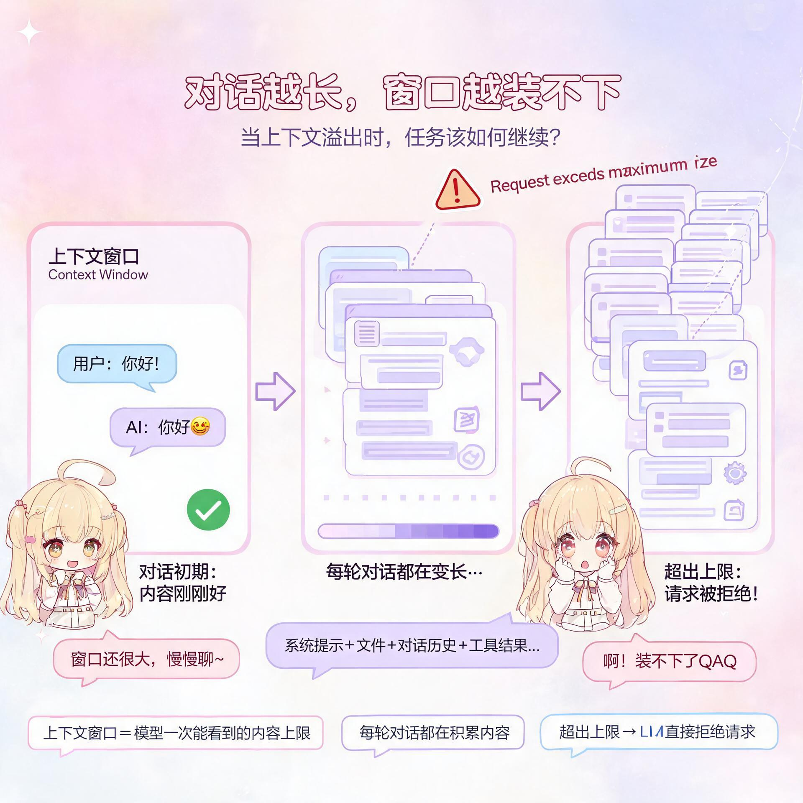
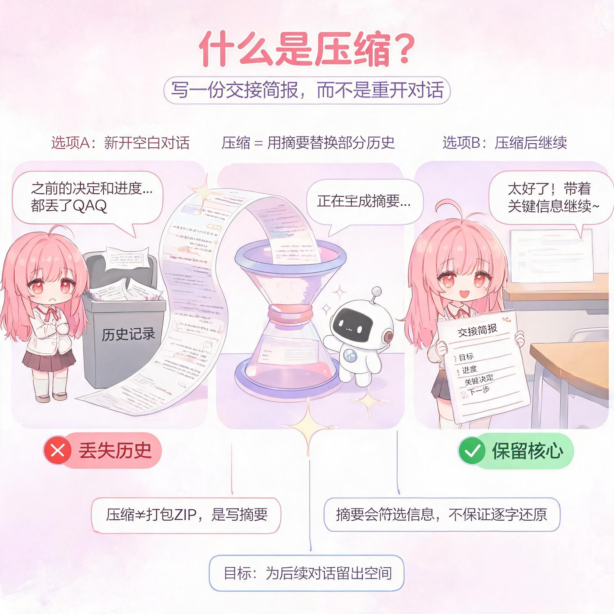
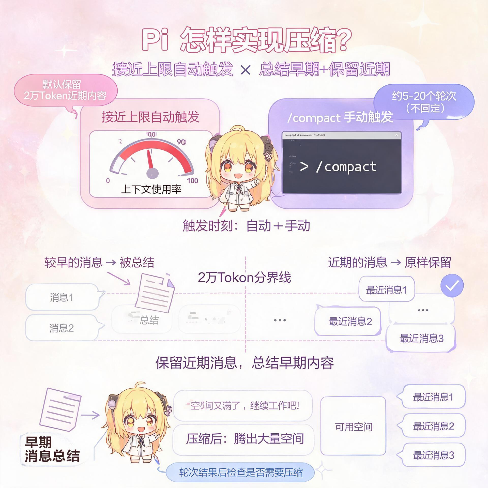
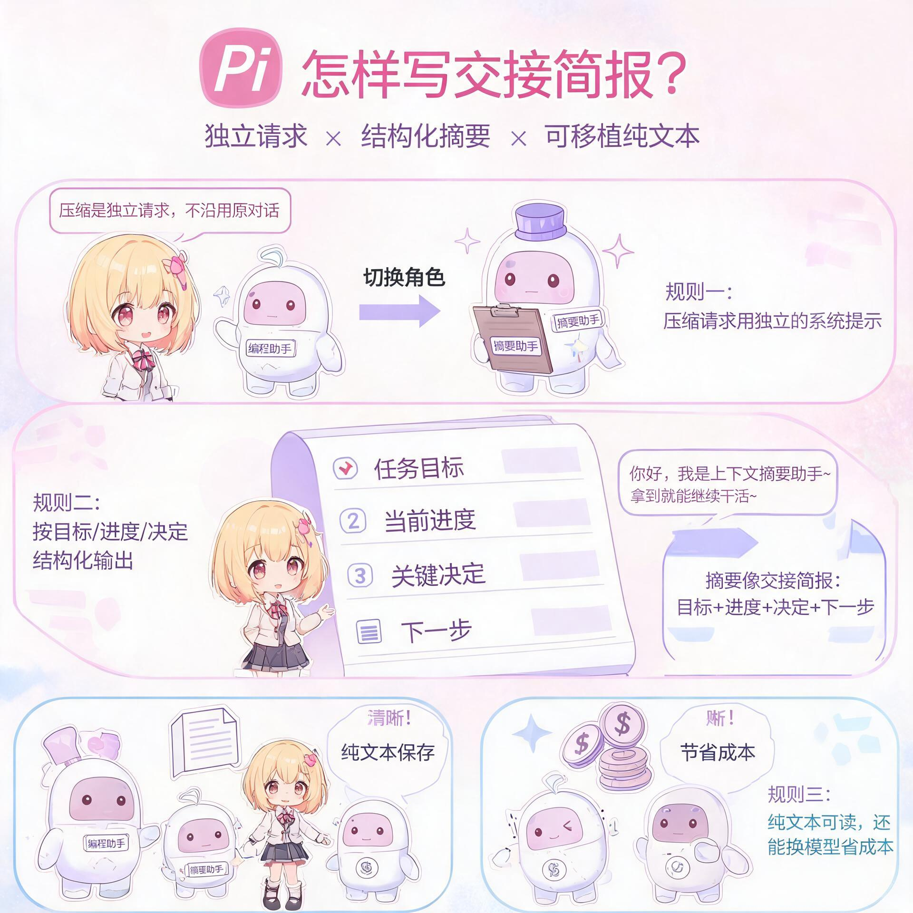
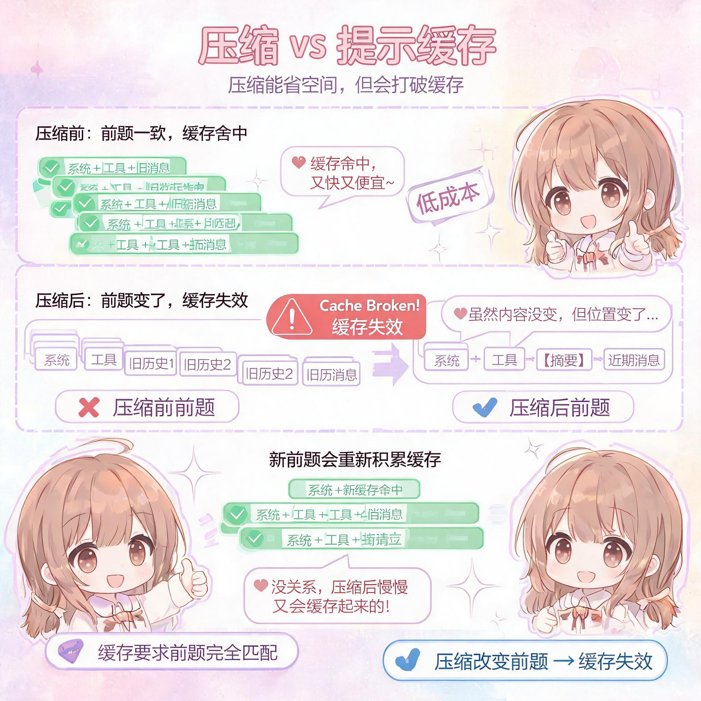
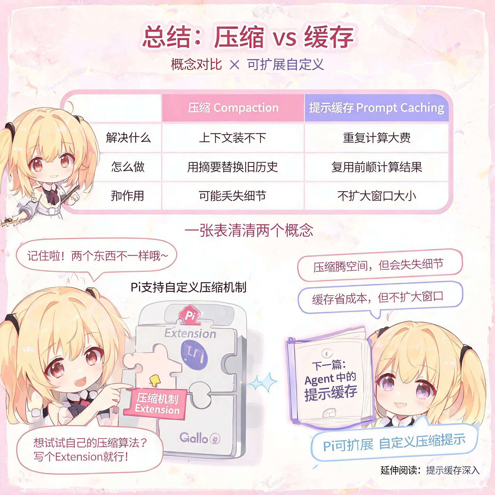

# 从零开始理解上下文压缩（How Compaction Works in Pi）【译】

上一篇《从零开始理解 Agent Harness》讲到，Harness 会执行模型发起的工具调用，把结果交回模型，让它继续判断下一步。

这些来回交互都会留下内容。你提出的要求、模型的回复、读取的文件和工具返回的结果，逐渐积累成一段越来越长的对话。

**当模型一次能读取的内容装不下这些记录时，任务该怎样继续？** 这一篇就来理解上下文压缩。

如果你曾在 Pi、Claude Code 或 Codex 这类编程 Agent 中进行过一次很长的编程会话，那么你一定触发过压缩。本文将解释压缩的工作原理，以及 Pi 会在什么时候需要压缩。

## 一次 LLM 对话（An LLM Conversation）

- **模型能看到什么**：这次请求中提供的上下文，包括指令、工具定义和对话历史。

- **为什么越聊越长**：新的消息和工具结果会不断加入后续请求。

大语言模型（LLM）的上下文窗口是有限的。上下文窗口就是模型在生成回复时能够“看到”的内容。LLM 所采用的 Transformer 架构限制了它能处理的输入量。编程 Agent 会话的输入包含此前的所有消息和工具调用，并会随着工作推进不断增长。一旦输入超出上下文窗口，LLM 就会拒绝这次请求。

与 Pi 这样的编程 Agent 交互时，Agent 会向 LLM 发送请求并接收回复。每次请求都包含系统提示、AGENTS.md 等已加载文件、工具定义和对话历史。

> **译者补充｜上下文可以理解为“本次交给模型的材料”。** 聊天窗口里显示的记录，与这一刻实际发送给模型的内容，不一定完全相同。本文先用尚未压缩的连续对话说明它如何增长，后面再看压缩后会发生什么。

编程 Agent 向 LLM 发出的第一次请求包含这些初始上下文，以及用户的第一条消息。

这会开启一个轮次。LLM 可能先返回一条包含工具调用的助手消息。Agent 程序执行这些调用，再把包含工具结果在内的完整对话发送给 LLM，然后得到另一条助手消息。当助手完成输出时，这个轮次就结束了。

> **译者补充｜一个轮次可能包含多次模型请求。** 比如你让 Agent 修复一个问题，它可能先读文件，再改代码、运行测试。这些工具调用和结果，会在同一个轮次中继续积累。

我们继续工作，并发送另一条消息。

每个轮次都会让对话变长。最终，历史记录会超出上下文上限。下一次请求便会返回类似 Request exceeds the maximum size（请求超出最大大小）的错误。

## 处理上下文溢出（Handling Context Overflow）

- **遇到的问题**：已有内容超出了模型能接收的范围。

- **可以怎么做**：重新开一段对话，或者把已有上下文压缩后继续。

当现有对话无法原样继续时，我们有两个选择。

1. 开始一段新的空白对话，不带上已经积累的上下文。这样会丢弃历史记录，包括先前的决定和尚未解决的工作。这样做仍可能是个好主意，因为上下文越长，LLM 的输出表现会下降。

1. 如果我们想继续这段对话，就为对话上下文创建一个更小的表示。这就是压缩所做的事情。

## 什么是压缩？（Compaction）

- **它负责什么**：用更短的表示替换部分历史记录，为后续工作留出空间。

- **常见做法**：让模型对早期对话生成一份摘要。

理论上，压缩有很多种实现方式。例如，我们可以编写一个确定性函数，保留对话中的部分内容并丢弃其余内容。但在实践中，压缩通常会通过一次 LLM 请求来总结对话历史。

**压缩会用一个压缩后的表示替换部分历史记录，从而为后续消息和工具调用留出空间。**

> **译者补充｜这里的压缩通常是“写摘要”。** 它不同于把文件打包成 ZIP：摘要会筛选和改写信息，可能省略细节，也不保证能逐字还原原对话。比如，一长串排查记录可以被概括为“已经检查了哪些地方、目前判断是什么、还有什么没完成”。

## Pi 怎样实现压缩？（Pi’s Implementation）

- **何时触发**：接近上下文上限时自动触发，也可以用 /compact 手动触发。

- **怎样处理**：总结较早的内容，同时原样保留一部分近期消息。

下面更仔细地看看 Pi 具体如何实现压缩。

当对话变得太长时，Pi 会用压缩来总结较早的内容，同时保留最近的工作。当上下文大小接近上下文窗口总容量时，压缩会自动触发；用户也可以使用 /compact 命令手动触发。

Pi 会在一个轮次结束后检查是否需要自动压缩。在此之前，每次请求都会在现有提示末尾继续追加内容，因此可以复用已经缓存的前缀。如果 Pi 在一个轮次进行到一半时遇到上下文溢出错误，也可能在轮次中途执行压缩。

压缩时，Pi 会原样保留一定数量的最近消息。

由于 Pi 使用可配置的 token 预算，实际保留的消息数量并不固定。按原文写作时的默认配置，Pi 会保留 2 万 token，大约相当于 5 到 20 个轮次。在这个分界点之前的所有消息都会被提取、序列化并接受总结。

> **译者补充｜Token 与轮次不是固定换算关系。** Token 是模型处理内容时使用的基本单位，不能直接等同于汉字数。一轮只聊一句话，与一轮读取很多文件，占用的 token 数可能相差很大。因此，原文的"5 到 20 个轮次"只是粗略说明，默认数值也可能随版本变化。

## Pi 怎样写这份"交接简报"？（Pi's Compaction Prompt）

对于编程 Agent 来说，一份好的摘要，理想效果就像一次从上一班到下一班的交接简报。Pi 的压缩提示强调，现有上下文中的大量内容已经不再相关；下一次 LLM 请求只应继续携带仍然重要的上下文。

> **译者补充｜想象一下工作交接。** 接手的人需要知道任务目标、已经完成的工作、关键决定，以及下一步该做什么。这也解释了为什么摘要不能只写“我们聊过代码问题”：它需要留下足以继续工作的线索。

因此，Pi 发出的压缩请求不同于普通对话请求。

1. 独立压缩请求所用的系统提示不同。它不会告诉 LLM“你是一名专业的编程助手”，而是告诉它：“你是一名上下文摘要助手。”

1. 压缩请求中的用户消息也不同。它要求生成“一份关于这条对话分支的结构化摘要，供以后返回时作为上下文。”提示中规定了目标、进度和关键决定等章节。

1. 这是一次独立请求，不直接沿用原对话的消息历史，因此也可以换用另一种 LLM，避免不必要的成本。

> **译者补充｜独立请求仍然需要读取待总结的内容。** Pi 会把需要压缩的历史整理后交给摘要请求。“不直接沿用原对话”指换了一套请求与提示组织方式，并不是模型凭空生成摘要，也不代表这次请求不消耗 token。

压缩结果会作为一条压缩记录追加到 Pi 会话中，随后会话便可以继续。压缩请求结束后，上下文已经被压缩。

此时，对话上下文中又有了容纳更多消息的空间。

Pi 会把压缩摘要以纯文本形式保存在会话中。这样一来，压缩后的上下文仍然可读且可移植，因为我们可以在 Pi 中切换模型，并继续使用这份摘要。

## 压缩与提示缓存（Compaction and Prompt Caching）

- **压缩解决什么**：让后续请求携带的内容更少。

- **缓存解决什么**：复用相同输入前缀已经完成的计算。

> **译者补充｜“前缀”就是输入从开头起连续相同的那一段。** 缓存可以复用这段输入对应的计算。若中途出现不同的 token，变化位置之后的内容就不能直接复用原来的状态。

LLM 提供商使用提示缓存来降低同一段对话中重复请求的成本。在活跃的编程会话里，对于已经由模型生成过的上下文，我们支付的费用会更低。这种缓存要求前缀完全匹配，因此压缩会打破提示缓存。

**保留的轮次仍然包含相同的 token，但它们现在出现在一个不同前缀之后，因此先前缓存的状态无法再复用。**

> **译者补充｜可以把两次输入并排比较。** 压缩前是“系统＋工具＋旧历史＋近期消息”，压缩后是“系统＋工具＋摘要＋近期消息”。近期消息虽然没变，前面却从“旧历史”变成了“摘要”，所以它们对应的计算状态也变了。

压缩后的新请求会重新开始受益于提示缓存。

## 试试自己的压缩方式（Experiment）

Pi 具有很强的可扩展性和可塑性，因此你可以用自己的压缩机制替换它原有的机制。如果想测试另一种压缩机制，可以让 Pi 创建一个带有自定义压缩提示的扩展（Extension）。

## 放在一起看

译者整理：上表帮助区分概念。压缩能留出空间，但摘要可能丢失细节；缓存能减少重复计算，但不会因此扩大上下文窗口。

上一篇介绍 Harness 怎样帮助模型完成任务，这一篇解释对话变长后怎样继续。下一篇可以接着读《Agent 中的提示缓存》，了解重复发送的上下文怎样复用计算。
